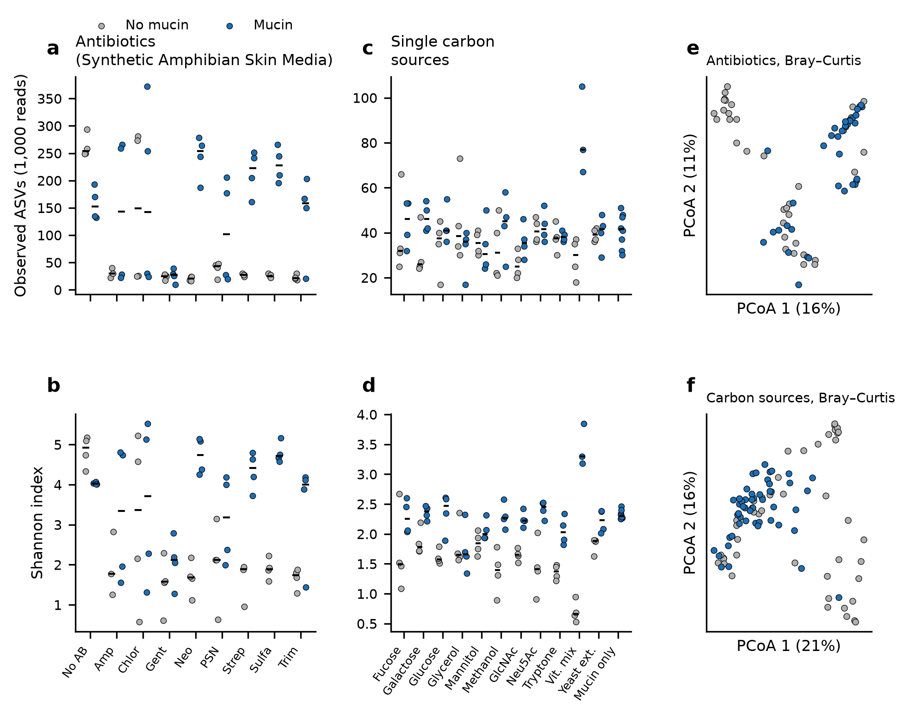
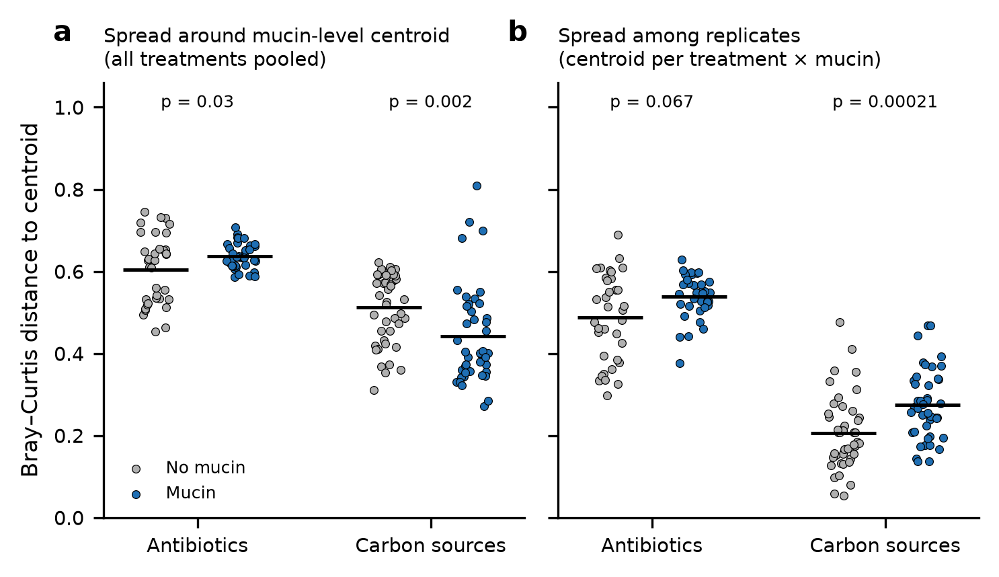
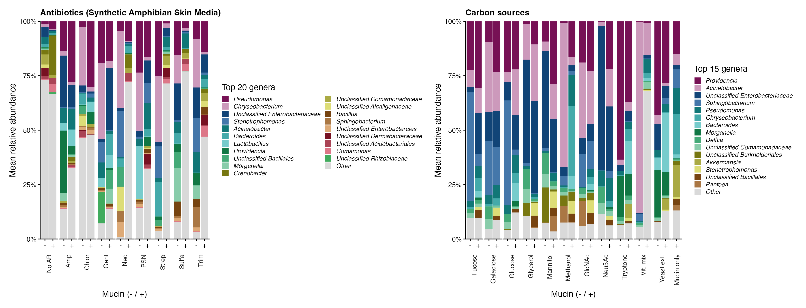
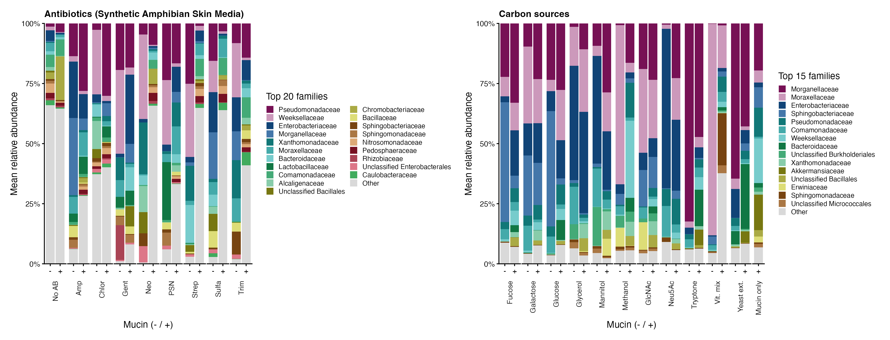
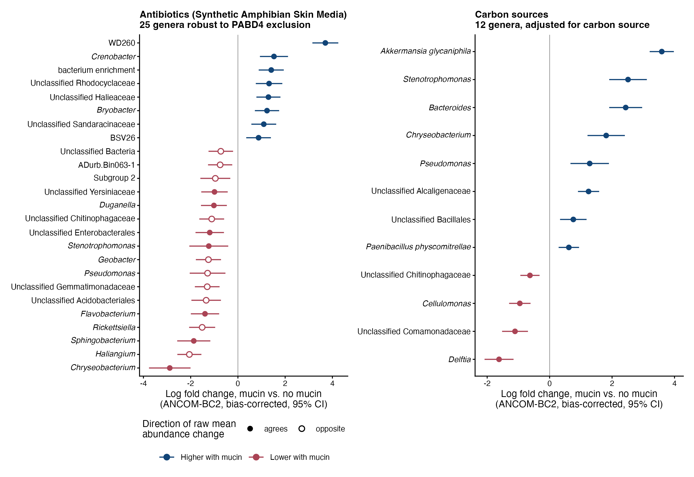
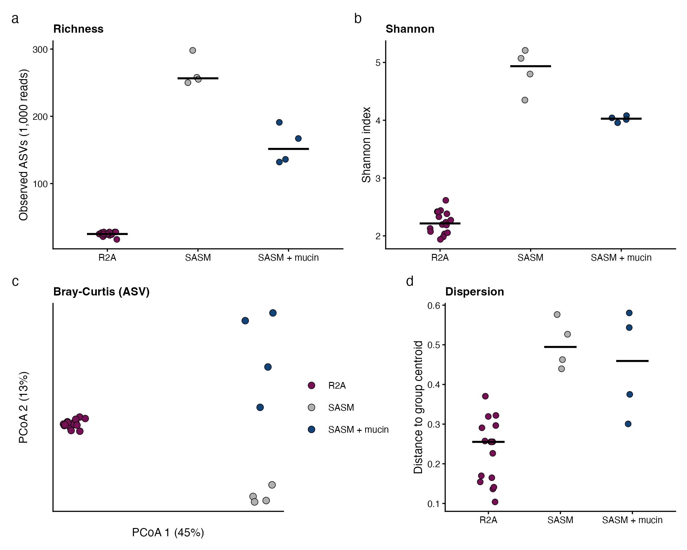
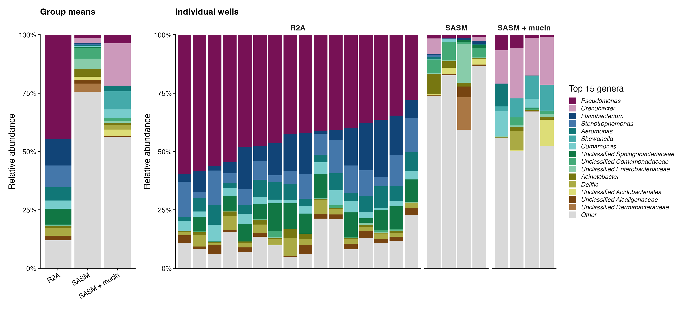

# Mucin effects on 20 °C synthetic-community 16S profiles (with R2A comparison)

## Data and sample set
- **Inputs:** `asv_table.txt` (480 samples), `synthcom_map.txt`, `taxonomy.tsv`.
- **Samples analysed:** 20 °C wells on two plates, 168 samples in total. Blank wells and the Diversity plate (plate 5) were excluded.
  - Plate 4, Antibiotics in Synthetic Amphibian Skin Media: 9 treatments (no antibiotic + 8 antibiotics) × mucin ±, n = 4 each (72 wells).
  - Plate 2, CarbonTemp: 11 single carbon sources × mucin ±, n = 4 each, plus 8 wells with mucin as the only carbon source (96 wells).
- **Filtering:** 46 chloroplast, mitochondrial, eukaryote and unassigned ASVs were removed, leaving 2,169 ASVs. **Archaea are kept**, because the current 515F/806R primers amplify them. That adds 19 archaeal ASVs (638 reads, 0.07% of reads, found in 29 of 168 wells, at most 3.5% of any well). None pass the 10% prevalence filter for genus-level ANCOM-BC2. No further contaminant filtering was done, because decontamination was done upstream.
- **Change from the previous version:** archaea are now kept. All conclusions are unchanged. R² values moved by ≤ 0.003, and the carbon-plate ANCOM-BC2 genus list is identical. On the antibiotic plate, 32 genera are significant (previously 31) and 25 are robust to PABD4 (previously 24; domain-level 'Bacteria' was added). Part of these small shifts comes from a new random rarefaction draw, because the count matrix changed.
- **Rarefaction:** samples were rarefied to 1,000 reads for diversity and dissimilarity analyses. P20H12 (182 reads) and PABD4 (827 reads) were dropped, leaving 166 samples (71 antibiotic, 95 carbon).
- **Mucin-only wells:** the 8 wells with mucin as the only carbon source have no no-mucin pair. They are plotted but excluded from the mucin × treatment models.
- **OD600 check:** the OD600 sheet for plate 4 (4 timepoints × 96 wells) matches `mucin_media_map.txt` well for well, with 0 mismatches. Blank wells stayed at OD ≈ 0.07 at every timepoint.

## Main results

### Antibiotics (Synthetic Amphibian Skin Media)
- **Richness:** mucin, antibiotic and their interaction all affect richness (rank ANOVA on observed ASVs: mucin F = 17.8, p = < 0.0001; interaction p = 0.0028).
  - With mucin, neomycin, streptomycin and sulfamethazine wells stay rich: median 252, 229 and 226 ASVs. Without mucin they drop to 20–27 ASVs.
  - The no-antibiotic control is the exception: 258 ASVs without mucin vs. 156 with mucin.
  - Wells are either rich (about 150–350 ASVs) or poor (about 20–40), with little in between. Ampicillin, chloramphenicol and PSN wells split 2/2 within a group.
- **Composition (PERMANOVA, Bray–Curtis):** mucin R² = 0.055, antibiotic R² = 0.138, interaction R² = 0.150 (all p ≤ 0.0047). Jaccard gives the same picture.

### Single carbon sources
- **Diversity:** mucin raises the Shannon index strongly (F = 125, p = < 0.0001). Richness rises only slightly (F = 11.2, p = 0.0014). Mucin mainly makes abundances more even rather than adding taxa.
- **Composition (PERMANOVA, Bray–Curtis):** carbon source R² = 0.435, mucin R² = 0.094, interaction R² = 0.221 (all p = 0.0001).
  - Mucin shifts composition within 9 of 11 carbon sources (BH-adjusted p < 0.05).
- **Genus-level differential abundance (ANCOM-BC2, adjusted for carbon source):** 12 of 115 genera differ and pass the sensitivity check.
  - Higher with mucin: Stenotrophomonas, Bacteroides, Chryseobacterium, Akkermansia_glycaniphila, Alcaligenaceae, Pseudomonas, Bacillales, Paenibacillus_physcomitrellae.
  - Lower with mucin: Delftia, Comamonadaceae, Cellulomonas, Chitinophagaceae.

### Both plates together
- In the combined model (treatment nested within experiment), experiment R² = 0.122, mucin R² = 0.025, and experiment × mucin R² = 0.038 (all p = 0.0001).
- Mucin acts differently in the two experiments. The base media differ and each plate is its own batch, so medium and plate effects cannot be separated.

## Beta dispersion

Mean Bray–Curtis distance to centroid:

| Experiment | Comparison | No mucin | Mucin | p |
|---|---|---|---|---|
| Carbon sources | pooled (one centroid per mucin level) | 0.513 | 0.442 | 0.002 |
| Carbon sources | among replicates (one centroid per treatment × mucin) | 0.206 | 0.275 | 0.00021 |
| Antibiotics | pooled | 0.604 | 0.637 | 0.03 |
| Antibiotics | among replicates | 0.488 | 0.538 | 0.067 |

- **Carbon sources:** the pooled spread is lower with mucin because mucin makes the carbon sources more alike. Carbon source explains R² = 0.81 of composition without mucin and 0.60 with mucin. The mean distance between carbon sources falls from 0.74 to 0.65.
  - Replicates of the same carbon source spread more with mucin, not less.
  - With Jaccard distances, replicate spread on the carbon plate is slightly lower with mucin, so the higher Bray–Curtis replicate spread reflects abundance changes.
- **Antibiotics:** mucin slightly increases spread.

## Community composition

- Each experiment has its own top taxa: the top 20 on the antibiotic panel and the top 15 on the carbon panel. Taxa are ranked by mean relative abundance within the experiment, without rarefaction. Bars are group means.
- The rich antibiotic wells keep a large "Other" fraction (median about 30%), because many low-abundance genera each fall outside the top taxa.

## Differential abundance (ANCOM-BC2)

- The points are bias-corrected log fold changes (mucin vs. no mucin) with 95% CIs, from genus-level ANCOM-BC2. The model adjusts for antibiotic or carbon source.
- **Antibiotic panel:** shows only the 25 genera that are significant both with and without PABD4. 8 are higher with mucin and 17 lower.
- **Carbon panel:** 12 genera, 8 higher and 4 lower with mucin.
- **Open markers:** the raw mean relative abundance changes in the opposite direction to the bias-corrected fold change. This applies to 10 of 25 antibiotic-plate genera and 0 on the carbon plate. These are mostly low-abundance taxa whose sign depends on ANCOM-BC2's sample-specific bias correction. Interpret them cautiously.
- ***Chryseobacterium*, *Pseudomonas*, *Stenotrophomonas* change in opposite directions on the two plates:** lower with mucin on the antibiotic plate, higher with mucin on the carbon plate. The mucin effect on these genera depends on the base medium.
- Script: `code/da_figure.R`. Plotted values: `results/differential_abundance_mucin_plotted.csv`.

## Comparison with R2A (same swabs)
- **Samples:** R2A wells without cortisol, n = 16 (S9 is listed in the map but missing from the ASV table). These are compared with the plate 4 no-antibiotic wells in Synthetic Amphibian Skin Media (SASM), without mucin (n = 4) and with mucin (n = 4).
- **Merging the tables:** ASV IDs are sequence hashes, so the R2A and SASM tables merge directly. 30 ASVs are shared, and their taxonomy is identical in both tables. Both tables use the same filter (each ASV has at least 10 reads in total).
- **Processing:** same as above (archaea kept, rarefied to 1,000 reads). Script: `code/r2a_vs_sasm.R`.

| | R2A | SASM | SASM + mucin |
|---|---|---|---|
| Observed ASVs (median) | 25 | 256 | 152 |
| Shannon (median) | 2.21 | 4.93 | 4.03 |
| Bray-Curtis distance to centroid (mean) | 0.23 | 0.50 | 0.45 |

- **Diversity:** R2A is much less diverse than either SASM group (Kruskal-Wallis p = 0.0003; pairwise BH-adjusted p = 0.0041). SASM vs. SASM + mucin gives p = 0.03, the smallest value possible with 4 vs. 4 wells.
- **Composition (Bray-Curtis):** medium explains R² = 0.52 (R2A vs. SASM) and 0.54 (R2A vs. SASM + mucin). Mucin within SASM explains R² = 0.30. Jaccard and genus-level Bray-Curtis give the same ranking.
- **Dispersion:** R2A replicates are much tighter than SASM replicates (betadisper p = 0.0001), so part of the PERMANOVA R² reflects this difference in spread. The PCoA still separates the media completely.
- **Overlap:** 74% of R2A reads are in ASVs also found in SASM, but only 6% of SASM reads are in ASVs found in R2A. R2A recovers a subset of the community that grows in SASM.

- **Stacked bars:** the top 15 genera are ranked by the mean of the three group means, so each medium is weighted equally.
  - **R2A:** *Pseudomonas* (45%), *Flavobacterium* (11%), *Stenotrophomonas* (9%) and *Aeromonas* (6%).
  - **SASM + mucin:** *Crenobacter* (18%) and *Shewanella* (8%), neither of which is detected in R2A.
  - **SASM without mucin:** very even, with 76% of reads in "Other".
- **Caveats:**
  1. The R2A samples reuse the plate 4 barcodes, so they were sequenced on a separate run. Medium and sequencing run cannot be separated.
  2. The frequency filter was applied across 480 samples for SASM but only 34 for R2A, which slightly favours keeping rare ASVs in SASM. This cannot explain a 10-fold difference in richness.

## Caveats
1. **Small groups:** with n = 4 vs. 4, single-treatment tests cannot reach p below about 0.029. Use them as descriptive.
2. **ANCOM-BC2 on the antibiotic plate depends on one sample.** With PABD4 excluded (the pipeline rule) 32 genera are significant; with it included, 61. 25 genera are significant both ways, always in the same direction; treat only these as robust. See `ancombc2_antibiotic_PABD4_sensitivity.csv`.
3. **Interpreting bias-corrected changes:** for some taxa the ANCOM-BC2 bias-corrected log fold change points the opposite way to the raw mean relative abundance. Check the raw abundances before interpreting a single taxon.
4. **Richness and read depth:** richness correlates negatively with read depth. Mucin wells have fewer reads. The OD data show mucin wells grow to higher density, so low read depth does not mean low biomass.
5. **Permutation p-values:** PERMANOVA and betadisper use 9,999 permutations, so rerunning the scripts can change p-values in the third decimal place.

## Reproducing
1. Run `Rscript code/analysis_20C_mucin.R asv_table.txt synthcom_map.txt taxonomy.tsv results`. This uses R 4.4.3 with vegan, tidyverse, phyloseq, ANCOMBC, ggh4x and patchwork; versions are listed in `results/sessionInfo_R.txt`.
2. Run `python code/figures_alpha_pcoa_dispersion.py results`. This needs numpy, pandas and matplotlib.
3. Run `Rscript code/da_figure.R results taxonomy.tsv` to draw the differential-abundance figure.
4. Run `Rscript code/r2a_vs_sasm.R asv_table_synth_com.txt cort_synth_com_map.txt taxonomy_r2a.tsv results/asv_table_20C_carbon_antibiotic.txt results/map_20C_carbon_antibiotic.txt taxonomy.tsv results_r2a` for the R2A comparison. The R2A taxonomy is the `taxonomy.tsv` supplied with the R2A table.
5. Optionally, run `python code/od600_map_check.py <OD screenshot.png> mucin_media_map.txt`. This transcribes the OD sheet by OCR (tesseract) and includes manual fixes for 8 misread well IDs.
